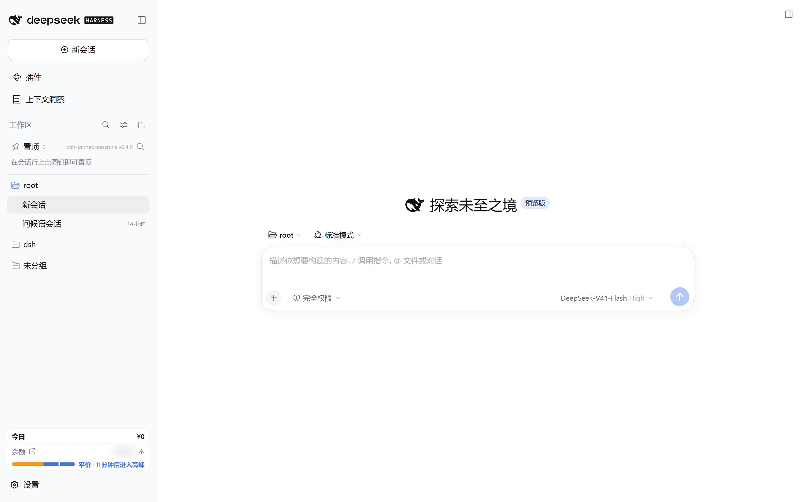
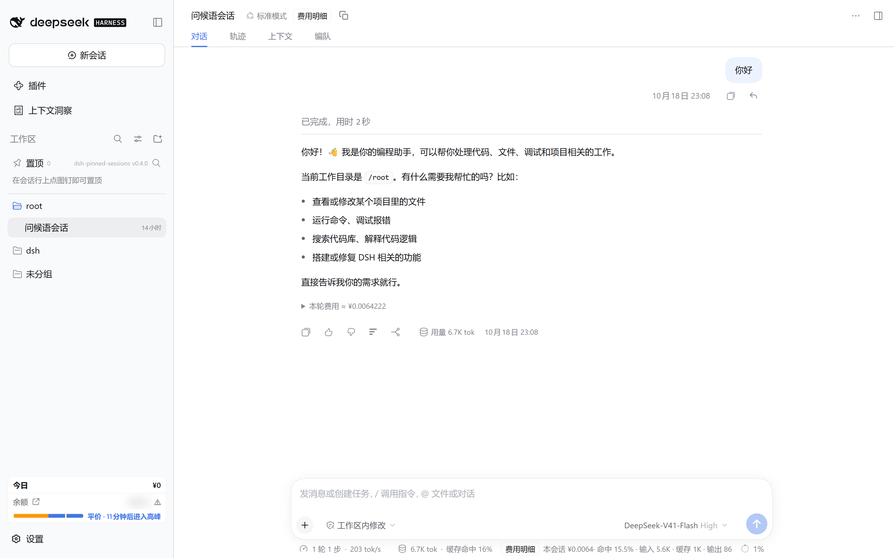
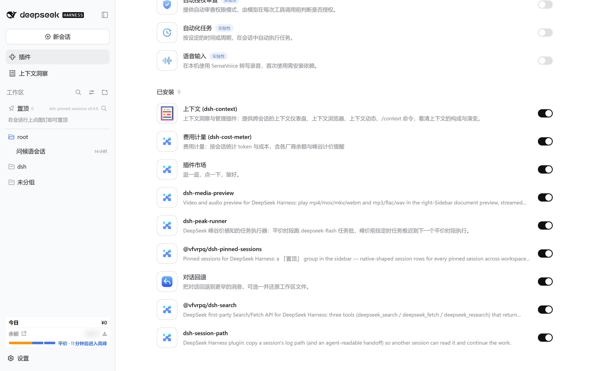
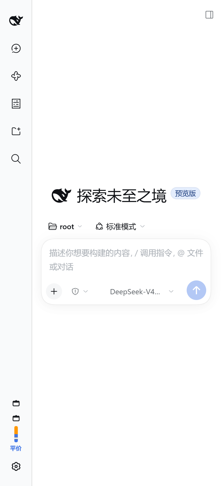

# 把 DeepSeek Harness 装进极空间 NAS：一份带代价的部署记录

## 一、为什么要把一个会执行命令的 agent 放到 NAS 上

我要的不是多一个服务，而是三件事：**常开**（会话有状态，PC 一关就断，NAS 本来就 7×24）、**手机和电脑同一套环境**（同一工作区、会话和配置）、**不用额外买机器或开云主机**（存储和备份本来就有，工作区原地就在备份里）。

代价先说：这台是极空间 Z4S（N6005 / N5105，15.42 GiB 内存），纯 CPU，能跑 agent 编排，**跑不了给 agent 用的本地模型**——MiMo 9B 实测 0.024 tok/s，而 DSH 一轮提示词 6627 token，所以是「NAS 当壳，模型走 API」。

另一条路是把 DSH 留在 PC 上、NAS 只当访问通道：原有的工作目录、skill 库、git 凭据都在，但 PC 一关就没了。我要的是常开，所以没选。

## 二、最终形态：一个容器、三个端口、四个挂载

| 项 | 值 |
|---|---|
| 容器名 | `zspace-dsh` |
| 镜像 | `node:latest`（Debian 版，1189 MB） |
| 网络 | `host` |
| 重启策略 | `always` |
| 启动命令 | `bash /dsh/conf/entrypoint.sh` |
| DSH 版本 | `0.2.0-rc.2`（`@deepseek-ai/dsh`） |

三个端口，**只有 19388 是给人用的**：

| 端口 | 是什么 | 要不要 token |
|---|---|---|
| `19387` | DSH 本体，`dsh web` 真正监听的地方 | 要，且每次启动都变 |
| `19388` | 稳定入口反代：读日志拿 token、换 cookie、注入后转发 | 不要 |
| `19389` | HTTP API 桥：把 headless 模式包成普通 HTTP 接口 | 要 `X-API-Key` |

四个挂载都是持久化目录，容器重建不丢：`/dsh/conf`（脚本、`api-key.txt`）、`/dsh/home`（`DSH_HOME`：会话、凭据、profile 补丁层）、`/dsh/npm`（CLI 安装位置）、`/workspace`（agent 工作区）。

host 模式下这三个端口直接绑在 NAS 上，且都监听 `0.0.0.0`——局域网内谁都能访问，这是后面必须给 19389 加 key 的原因。日常维护很轻：升级只改 `DSH_VERSION` 后重启；备份整个 `/dsh/home` 就等于备份了会话、凭据和配置；卸载是删容器再删目录，不碰系统。

极空间特有的坑：**给 dockerd 的路径和文件管理器里看到的不是同一个**。`/sata1/...` 是文件管理器视角，dockerd 只能看到 `/tmp/zfsv3/sata1/...`，`Binds` 必须写后者；两套指向同一份数据，实测写入后回读一致。

## 三、跑起来是什么样

先看结果，再决定要不要照着做。下面说的是装完之后**实际的界面和实际的行为**。

**打开网页**：左边是会话列表，可以新建、按工作区分组；顶部能选工作区和模型；下面是输入框。



会话列表、工作区、模型选择器和输入框都在一屏内，这就是装完第一次打开的样子。

**能直接对话**：输入框里说一句就行，回复会带回 token 用量和耗时。



一轮"你好"的实测：203 tok/s、6.7K tok、缓存命中 16%、本轮 ¥0.0064222。

**插件装好之后界面会多一些东西**：侧栏底部的费用统计、上下文仪表盘、设置里的插件市场 tab、置顶会话分组、消息上的 ↶ 回退按钮。



设置 → 插件里"已安装 9"，9 个第三方插件都在。

**换设备**：手机走极空间 App 的「远程访问」，电脑直接用浏览器，打开的是**同一个地址、同一份会话历史**。在手机上开个头，回到电脑上接着聊，上下文还在。



手机视口下侧栏折叠成图标栏，输入框和模型选择器都还在。

**三个端口各是什么样子**（都是实测）：

| 端口 | 直接打开会看到 |
|---|---|
| `19387` | 401，正文是 `dsh web authentication required`——这是对的，说明围栏在 |
| `19388` | 正常界面，HTML 里已经注入了兼容垫片 |
| `19389` | 一段说明页（`GET /`），真正干活的是 `POST /v1/ask` |

一句话：你要的是一个**常开、换设备也能用、能真正执行命令**的编码助手，不是一个只会聊天的页面。

## 四、从 0 到 1：完整部署步骤

前一节是结果，这一节是操作顺序。下面按"需要什么 → 建容器 → 验收"排；照做的话，除了极空间界面上的按钮位置，其他都可以直接照抄。

### 4.1 你需要什么

- 一台能跑 Docker 的极空间（本文在 Z4S / N6005 / 15.42 GiB 上验证；型号和 Docker 版本差太远的话，后面每一步都可能要重新试）
- 极空间账号，且客户端里能开「远程访问」
- DSH `0.2.0-rc.2`——**其他版本没有验证过**
- 不需要：公网 IP、域名、DDNS、SSH、WebDAV

`entrypoint.sh` 只依赖 bash 和 node，所以不用在极空间上开 SSH。

### 4.2 动手前必须知道的三个事实

**一、必须用 host 网络。** 这不是偏好，是被两边的限制夹出来的。极空间建容器默认 bridge；容器里 `networkInterfaces()` 只看到自己的 `172.x`，DSH 拿它推导"局域网可信地址"时**不含极空间的真实 IP**，于是带 `Host: <你的NAS>:19387` 的请求被 `/api` 围栏拒掉，表现为"页面能打开、应用全 403"。手动填 `DSH_PUBLIC_HOST`？极空间没有可靠接口读自己的局域网 IP（`/network-settings/v1/network/config/show` 只返回 `{"advanced":false}`，客户端的 `nas.nasIp` 也是空的），等于让你猜。换 `host` 后容器共享 NAS 网络命名空间，DSH 直接读到 NAS 的真实网卡，局域网地址被自动信任，`DSH_PUBLIC_HOST` 可留空；端口就是 NAS 的端口，而远程访问域名是通配的 `remote-access-<端口>.zconnect.cn`，19388 不用单独建条目。代价是**没有端口隔离**：三个端口对局域网直接可达。

**二、极空间的 Docker 管理走桌面客户端的本地网关** `127.0.0.1:13579`，而且接口方法不统一：`container_op` 是 GET，`system_restart` 是 POST，`/system/reboot` 在另一个命名空间。端点清单在仓库 `docs/zspace-docker-api.md`，方法上的坑见 §6.3。

**三、路径有两套视角**：文件管理器里是 `/<你的存储池>/…`，dockerd 看到的却是 `/tmp/zfsv3/<你的存储池>/…`。建容器时 `Binds` 必须写后者，详见 §2。

### 4.3 准备目录与四个挂载

先在文件管理器里建好四个目录，它们全都持久化，容器重建不丢：

| 容器内 | 文件管理器里 | 装什么 |
|---|---|---|
| `/dsh/conf` | `/<你的存储池>/dsh/conf` | 三个脚本、`api-key.txt`、`trusted_hosts.txt`、`extra.patch.yml` |
| `/dsh/home` | `/<你的存储池>/dsh/home` | `DSH_HOME`：会话、凭据、`10-listen.yml`、`container.log` |
| `/dsh/npm` | `/<你的存储池>/dsh/npm` | dsh CLI 的安装位置（升级不重装） |
| `/workspace` | `/<你的存储池>/dsh/workspace` | agent 的工作区 |

`Binds` 里把左边换成 `/tmp/zfsv3/<你的存储池>/dsh/…`。

### 4.4 三个文件：entrypoint / 代理 / API 桥

这三个文件是这套部署独有的，**DSH 本身不需要它们**；仓库里是 `conf/entrypoint.sh`、`conf/entry-redirect.js`、`conf/dsh-api-bridge.js`。

**`entrypoint.sh`** 按顺序干五件事：

1. **幂等装 DSH**：比对 `dsh --version` 与目标版本，不一致才装（先 npmmirror，失败回退官方源）。装在挂载卷里，版本不变就不重装。
2. **尝试装 bubblewrap**（Linux 沙箱首选后端），失败只告警——后面会看到这是伏笔。
3. **生成监听覆盖层**并组装 `--trusted-host`，来源是环境变量和 `conf/trusted_hosts.txt`（逐行过滤，非 `host`/`host:port` 形状的 token 直接丢掉）——带 UTF-8 BOM 时，BOM 会被当成一个"地址"，DSH 会因它不是合法 authority 拒绝加载整个插件。
4. **起 `dsh web --no-open`**，stdout 写进 `container.log` 并回显，同时抓 `?token=` 写进 `entry-url.txt`。
5. **起 19388 代理和 19389 桥**，`trap TERM` 时一起收掉。

第 3 步是它最"越界"的地方：DSH 明确拒绝对外监听，`dsh web --host 0.0.0.0` 会被它怼回来：

> `--host 0.0.0.0 is intentionally not supported yet for safety: it would expose remote code execution to the network`

理由是对的：它能执行任意命令，挂到网上就是暴露 RCE。我**不改它的代码**，只在配置层（`--patch`）把 `webserver.host` 写成同一个值，绕过 CLI 守卫——能力可行，风险要自己知情。entrypoint 每次启动生成 `/dsh/home/10-listen.yml`：

```yaml
- id: webserver
  config:
    host: '0.0.0.0'
    port: 19387
    compression: gzip
    compressionLevel: 1
    compressionThresholdBytes: 1024
```

注意 `patch` 对同一插件的 `config` 是**整块替换**，不是深合并，原有键必须写全。

**`entry-redirect.js`** 是 19388 稳定入口：读 `container.log` 尾部拿 token、换 cookie、改写 `Host`/`Origin`、给 HTML 注垫片。机制和踩过的坑见 §5.1、§5.1.1、§5.2。

**`dsh-api-bridge.js`**（可选）是 19389，把 `dsh --profile headless` 包成 HTTP。密钥放 `conf/api-key.txt`，**至少 16 字符，缺失即拒绝一切请求**；没有就先建一个，填 16 位以上随机字符。见 §5.3。

### 4.5 建容器

极空间不是命令行建的：在 Docker 界面（或它的 API）里按下表填。

| 字段 | 值 | 为什么 |
|---|---|---|
| 镜像 | `node:latest`（Debian，约 1.2 GB） | 自带 bash 与 node，够跑 entrypoint |
| 容器名 | `zspace-dsh` | 与文中命令、脚本里的名字一致 |
| 网络 | `host`，**不要端口映射** | host 下端口就是宿主机端口 |
| 重启策略 | `always` | 整机重启后自动回来 |
| 启动命令 | `bash /dsh/conf/entrypoint.sh` | 脚本在挂载卷里，重建容器不丢 |
| Binds | 上面四条 | 路径必须是 `/tmp/zfsv3/…` |

环境变量按这张表填：

| 变量 | 值 | 作用 |
|---|---|---|
| `TZ` | `Asia/Shanghai` | 时区，日志和会话时间都用它 |
| `DSH_VERSION` | `0.2.0-rc.2` | 要装的 DSH 版本，升级改这里 |
| `DSH_PORT` | `19387` | 容器内监听端口；host 下与宿主机一致 |
| `DSH_PERMISSION_MODE` | `danger-full-access` | 沙箱模式；默认的 `workspace-write` 在这个镜像里起不来，见下 |
| `DSH_TRUSTED_HOSTS` | 可留空 | 额外信任地址，空格分隔 |
| `DSH_PUBLIC_HOST` | 留空 | host 网络下可留空 |

`DSH_PERMISSION_MODE` 要写 `danger-full-access`：`node:latest` 里没有 bubblewrap、宿主也没开 Landlock，默认的 `workspace-write` 会让 agent 连 `ls` 都起不来；而 `danger-full-access` 配的是 `approval: never`，不需要审批通道（代价见 §6.4）。

镜像 tag 还有一个坑：极空间的 `image_pull` 会忽略 `image_tag`，要精确 tag 只能在界面里拉。

如果你是在**普通 Docker 主机**上复现（不是极空间），命令是这样（注意**没有 `-p`**，host 模式下端口就是宿主机端口）：

```bash
docker run -d --name zspace-dsh \
  --network host \
  --restart always \
  -e TZ=Asia/Shanghai \
  -e DSH_VERSION=0.2.0-rc.2 \
  -e DSH_PORT=19387 \
  -e DSH_PERMISSION_MODE=danger-full-access \
  -v <NAS上的目录>/conf:/dsh/conf \
  -v <NAS上的目录>/home:/dsh/home \
  -v <NAS上的目录>/npm:/dsh/npm \
  -v <NAS上的目录>/workspace:/workspace \
  node:latest \
  bash /dsh/conf/entrypoint.sh
```

在极空间上参数一样，只把 `Binds` 换成 `/tmp/zfsv3/...`。

### 4.6 启动与验收

别用"页面能打开"当标准。另外这三条边界我逐条打过：带正确 token → **303 + 下发签名 cookie**；`/api/*` 用没声明的 Host → **403**；声明了但没 cookie → **401**。

| 检查 | 期望 | 不符合说明什么 |
|---|---|---|
| `http://<NAS>:19387/` 裸访问 | **401** | 200 = token 围栏没生效，危险 |
| `http://<NAS>:19388/` | **200**，且 HTML 里能找到 `AbortSignal.any` 的垫片 | 401 = token 没抓到；白屏 = 改写后的 header 没清干净 |
| WebSocket `/api/remote.mux` | **101** | 卡在「正在加载模型…」= `Host`/`Origin` 没同步改 |
| `http://<NAS>:19389/health` | 200，`workspace` 指向 `/workspace` | 若 `/v1/ask` 返回 401 = `api-key.txt` 没读到或短于 16 字符 |

### 4.7 配极空间的「远程访问」

把 **`127.0.0.1:19388`** 加进去：客户端只隧道这一个本地端口，手机和电脑都用它，容器重启也不变。19387 和 19389 都不要加——前者带一次性 token，后者是要 key 的接口。

手机上的用法一样：在客户端里打开这个远程访问条目，客户端把本地端口隧道到 NAS 的 19388（实测手机上是 `127.0.0.1:20080`），全程只用一个端口，所以不用记 IP，也不用重新拿 token。

## 五、三个必须自己补的组件

这三样都不改 DSH 一行代码。用词先对齐：这里的"反代"是**反向代理**，代表的是服务器，不是客户端。

| | 代表谁 | 谁不知道真相 |
|---|---|---|
| 正向代理 | 代表**客户端** | 服务器不知道背后是谁 |
| **反向代理** | 代表**服务器** | 客户端不知道背后是谁 |

正向代理是跑腿，反向代理是前台：你以为在跟公司说话，其实前台在转接，顺手把材料改对了递进去——改 `Host`/`Origin`、换 cookie、注垫片都是。

为什么不用 nginx：它得读日志抠 token、改响应体注入 `<script>`、再同时改 Host/Origin，这些都超出配置能表达的范围，得上 Lua 或编译模块。不如直接写一个三百行、只做这一件事的 Node 脚本。

### 5.1 稳定入口：把每次都变的 token 挡在门外

DSH 的入口 token **每个进程随机生成**（源码里 `randomBytes(32)`，没有配置项），容器一重启就变；直接发带 token 的地址，几次后全成 401。

`entry-redirect.js` 的做法：每次请求读日志尾部 128 KB，取最后一次出现的 `?token=`（20 字符以上），用它请求 `/?token=…` 换到 `dsh-auth` cookie，缓存 6 小时（DSH 的签名 cookie 本身是 30 天），然后注入 cookie、把 `Host` 改写成 `127.0.0.1:19387`，在 NAS 内部转发；响应里的绝对 `Location` 改写成相对路径，避免浏览器被带去没有隧道的端口。

**为什么不是 302 跳转**：第一版就是跳转，局域网没问题，走极空间客户端隧道时会断。客户端只隧道它那一个本地端口（实测手机上是 `127.0.0.1:20080`），而跳转目标恒为 `:19387`，浏览器于是被带到**客户端设备自己的 19387**：手机是"网页无法打开"，PC 更糟——PC 自己的 DSH 就占着 19387，拿到 401。改成代理后客户端全程只用一个端口。代理起来后会自检一次，日志里 `status=200` 表示拿到的是 DSH 界面；401 说明 token 没换到 cookie。

#### 5.1.1 token 到底是什么

`app.asar` 里有 DSH 的设计文档，`## Browser authentication and request trust` 一节把这件事写死了：

> Over the Web carrier, every Host RPC method and WebSocket stream requires an authenticated browser or API Peer … **Each process mints a random launch token.** `dsh-web-app` **prints and opens its application URL with `?token=...`** … `frontend-static` delegates root and index requests to `ctx.connection.authorizeIndex`, which **accepts that token only on `GET /`**, writes an **authority-bound signed cookie**, and **redirects to clean `./`, which drops the token** … A missing, expired, malformed, or **wrong-authority cookie returns 401 before RPC dispatch.** **Static assets remain public.**

源码只是给 URL 塞一个查询参数：

```js
authenticatedUrl(baseUrl) {
  const url = new URL(baseUrl);
  url.searchParams.set(TOKEN_QUERY, this.launchToken);
  return url.href;
}
```

三点值得记住：

1. 变量叫 `launchToken`：由 `processOwner` 持有、跨 Connection reload 保留，但**每进程只铸一次**，进程一重启就换，所以 URL 每次都变。
2. 它只在 `GET /` 上被接受一次，通过后换成**签名 cookie**，再重定向到 `./`，token 从地址栏消失，之后全靠 cookie。那句 401 在 `dsh-client-connection/lib/index.js:449`，`TOKEN_QUERY` 与 `tokenMatches()` 在 226 / 279 / 391 / 394 行（容器里的解包状态）。
3. **静态资源不设防**——这正好解释一个常见症状：HTML/JS/CSS 都能加载，数据却出不来，因为门只锁在 `/` 和 `/api` 上。

#### 5.1.2 为什么 Electron 不需要这层代理

同一份 DSH，桌面版为什么不用折腾 token？差别不在门，在**谁在开门**。

| | 谁在开浏览器 | 有没有资格拿 token |
|---|---|---|
| 本地 Electron | **它自己的 WebView** | ✅ `launchToken` 就在启动服务器的那个进程里，主进程直接把带 token 的地址交给 WebView |
| 极空间的远程访问 | **极空间客户端的内置浏览器** | ❌ 第三方浏览器，不知道也不该知道 token |

门对谁都一样：都得 token 换 cookie。Electron **从里面开**：主进程代劳，用户看不见 token；极空间**从外面开**：用户拿不到 token，才需要 19388 代劳。

实测：本地 Electron 的 DSH 监听在 `127.0.0.1:58146`（本次运行的随机端口），不带 token 访问返回 401，带假 token 也是 401——门确实是关着的。至于哪一行 `loadURL` 把地址交给 WebView，我没挖到，这里是推断：它必然在同一进程里拿得到 `launchToken`。

### 5.2 老浏览器垫片：不是为了兼容，是为了能点开

极空间客户端内置内核比 Chromium 116 老，而 DSH 界面用了 `AbortSignal.any()`。表现不是白屏，是界面能渲染、但一点"选择工作区目录"就红字报 `AbortSignal.any is not a function`。

代理对 HTML 响应注入垫片，插在 `</head>` 之前（找不到就插在 `<body>` 后），保证在应用脚本前执行。补的是同批次常见缺失的一整套：`AbortSignal.any/timeout`、`Object.hasOwn`、`Array/String` 的 `at`/`findLast`/`replaceAll`/`toSorted`、`Promise.withResolvers`、`structuredClone`。新浏览器上全是空操作。

这**不是 DSH 插件**：`entry-redirect.js` 是独立 Node 进程（`http` 模块手写，313 行 / 11.5 KB），由 `entrypoint.sh` 拉起，和 DSH 并行跑，DSH 不知道它存在。垫片本体是一段内联字符串，靠字符串替换塞进去：

```js
const POLYFILL = `<script>(function(){ ... })();</script>`;
if (body.includes("</head>")) body = body.replace("</head>", POLYFILL + "</head>");
else if (body.includes("<body")) body = body.replace(/<body[^>]*>/, (m) => m + POLYFILL);
```

精确数是 12 个：`AbortSignal.any`、`AbortSignal.timeout`、`Object.hasOwn`、`Array.prototype.at`、`Array.prototype.findLast`、`Array.prototype.findLastIndex`、`Array.prototype.toSorted`、`Array.prototype.toReversed`、`String.prototype.replaceAll`、`String.prototype.at`、`Promise.withResolvers`、`window.structuredClone`。

三个实现细节都是踩出来的：**只对 HTML 路径改写**（`/`、`/index.html`、`*.html`），其余流式透传，否则 633 KB 的 JS 也要读进内存；这些路径**去掉 `accept-encoding`** 拿明文；改写后**必须同时删 `content-length` 和 `transfer-encoding`**（还有 `content-encoding`）再重设长度，只删一个会得到 `HPE_INVALID_CONTENT_LENGTH`。

```js
if (html) delete headers["accept-encoding"];   // 要改写就必须拿明文
delete outHeaders["content-length"];           // 长度变了要重算
delete outHeaders["transfer-encoding"];        // 上游分块，会和新的 content-length 冲突
outHeaders["content-length"] = buf.length;     // 只删不算 → HPE_INVALID_CONTENT_LENGTH → 白屏
```

### 5.3 HTTP API 桥：给一个没有 REST 面的东西加 REST

DSH 自身**没有可网络直连的 REST 面**：`/api/*` 全部 404（界面走 WebSocket，路径写死在 `dsh-api-gateway` 的 `/api/remote.mux`）；`--profile sdk` 是 stdio JSON-RPC；`--profile headless` 本来就是一次性 CLI。

所以加了 `dsh-api-bridge.js`（19389），把 `dsh --profile headless --json` 包成 HTTP。选它而不是 sdk：自带 `--session-id`，能续接持久化会话，事件流第一行就给出 `sessionId`，每次调用是独立进程，不用维护常驻连接。`spawn` 还做了三级回退（原样 → 绝对路径 node + 脚本 → PATH 里的 node）：带 shebang 的脚本在解释器不在 PATH 上时，Node 报的是 `ENOENT`，看着像"文件不存在"。

接口很小：`GET /` 是给浏览器看的说明页，`GET /health` 返回诊断，两者无需鉴权；`POST /v1/ask` 要 `X-API-Key`，body 是 `{"task":"…","sessionId":"…"}`；`GET /v1/ask?key=&task=` 等价 POST，供浏览器直测。

密钥放 `conf/api-key.txt`，**桥读文件而不是读环境变量**，轮换密钥不用重建容器。文件缺失或短于 16 字符时**拒绝一切请求**（fail-closed）——这个接口等价于"在你的 NAS 上执行任意 DSH 任务"，裸奔等于把 NAS 交出去。所有请求**串行排队**（DSH 是单 agent），每次请求拉起一个进程、15 分钟超时，没有流式输出，也不是给高并发用的。

bash 用法：

```bash
KEY=$(cat <NAS上的目录>/conf/api-key.txt)

curl -s -X POST http://<你的NAS>:19389/v1/ask \
  -H "X-API-Key: $KEY" -H "Content-Type: application/json" \
  -d '{"task":"只回复两个字：收到"}'
```

PowerShell 版（`KEY=$(cat …)` 在 PowerShell 里不成立，`$KEY` 会是空值，直接 401）：

```powershell
$k = (Get-Content "<NAS上的目录>\conf\api-key.txt" -Raw).Trim()
Invoke-RestMethod -Method Post -Uri "http://<你的NAS>:19389/v1/ask" `
  -Headers @{ "X-API-Key" = $k } -ContentType "application/json; charset=utf-8" `
  -Body ([Text.Encoding]::UTF8.GetBytes('{"task":"只回复两个字：收到"}'))
```

实测：第一轮让它建 `hello-api.txt`，12 秒返回；第二轮带上 `sessionId` 问"刚才那个文件里写的是什么"，10 秒返回正确答案，多轮记忆生效。

#### 5.3.1 设计用途和实际用途不是一回事

| | 设计用途 | 实际用途 |
|---|---|---|
| 面向 | 脚本、cron、webhook | **开发期运维** |
| 做什么 | 驱动对话、coding | **在 NAS 上跑运维脚本** |
| 为什么能 | —— | 桥 spawn 的是 `dsh --profile headless`，**agent 自带 bash**，事实上是远程 shell |

6 次调用，内容都是同一句"运行这条命令并把完整输出原样返回"：

```
15:30:29  install-plugins  92s   装 9 个插件
15:31:46  repair-node      13s   补宿主包软链
15:32:12  repair2.sh       14s   找宿主包真实位置
05:30:47  dig-token.sh     30s   挖 launchToken 出处
05:31:26  dig-token2.sh    29s   挖第二轮
05:34:22  dig-electron.sh  12s   查 dsh-desktop-host
```

容器里没有 `docker exec`，装插件、修被 pnpm 剪掉的宿主包、挖 token 出处都只能经它做——设计之外长出来的能力。代价是密钥配 `danger-full-access` 等于远程代码执行：它更像一把能进容器的钥匙，不是聊天 API。密钥已 gitignore，轮换是改文件重启；只读沙箱能收窄，但装插件就不行，我选择保留。

### 5.4 这三样都是补丁，不是能力

代理补的是"token 每次变 + 客户端只隧道一个端口"，垫片补的是"客户端内核太老"，桥补的是"没有 REST 面"。它们都工作在 DSH 之外，所以 DSH 升级后要重新验一遍——最可能先坏的就是这三处。

还有一处我绕开的东西：DSH 的网页设置页在非回环地址下**默认不可用**（客户端里是 `remote.$host.isLoopback ? "host" : "memory"`，非回环时不加载设置镜像），所以模型配置走 profile 补丁层 + `$DSH_HOME/.env`。后来我用 profile 遮蔽库存插件，把这个闸门做成显式配置项，设置页才可用——但这绕开的是 DSH 保护凭据的**有意策略**，含义是"任何拿到有效会话的人也能改设置"。对单人 NAS 就是你自己，不过要知道自己在关一个保护。

## 六、四个只有实测才会知道的坑

### 6.1 客户端内核老：`AbortSignal.any is not a function`

**现象**：界面正常渲染，点"选择工作区目录"红字报错。**根因**：客户端内核低于 Chromium 116，没有 `AbortSignal.any`。**修法**：注入垫片，见 §5.2。

### 6.2 改了 Host 没改 Origin：界面永远在「正在加载模型…」

**现象**：页面能开、模型列表也出来了，但永远转圈显示"正在加载模型…"；中转看到的是 502，代理日志里没有 `ws upgraded`。

**根因**：DSH 的界面取数据不走 REST，走 WebSocket `/api/remote.mux`，这条断了界面就是永远转圈。代理为绕开 Host 围栏把 `Host` 改写成了 `127.0.0.1:19387`，但浏览器的 `Origin` 还是 `https://remote-access-19388.zconnect.cn`。**两者不一致，DSH 判成跨源**，拒绝 WebSocket 升级（HTTP 400，中转再包成 502）。

**修法**：`Origin` 跟着 `Host` 一起改写：

```js
if (h.origin) h.origin = `http://${TARGET_HOST}:${TARGET_PORT}`;
```

**反直觉的点**：把 19388 的域名加进 `--trusted-host` **不管用**，实测加了仍然 502。白名单管的是 Host 围栏，跨源检查是另一件事。

### 6.3 `container_op` 是 GET；而 `system_restart` 救不了 containerd

**现象**：容器列表显示 `running` / `Up N hours`，但端口 502；`container_top` 报 `dial unix:///run/containerd/containerd.sock: timeout`；`container_op` 的 start/stop/restart 返回 `{"code":"200","data":null}` 但完全不生效。

**根因**：**containerd 挂了**。dockerd 还能读写自己的元数据（所以列表看着正常），但所有容器生命周期操作都要经 containerd，于是全部失效——包括"只重启某一个容器"这件事，此时根本不存在。排除项也都试过：磁盘没满（26.5 GB 已用，存储池剩 12.7 TB）、dockerd 活着（`system_info.SystemTime` 是当前时间）、同一中转下其他端口正常。

**方法上的坑**：`/zdocker/container_op` 是 **GET**，传 POST 一律 404；`/zdocker/system_restart` 反而是 **POST**。我图省事用默认 GET，发成 GET → 404 → 误判"接口失效"，白跑两轮。**先确认方法，再怀疑接口**。

**修法**：`system_restart` 只重启 dockerd，**不动 containerd**，所以无效；`system_switch` 同样无效。唯一能救的是整机重启：

```bash
# 极空间没有 docker CLI，这些请求要经桌面客户端网关并带网页端会话 cookie
curl -s -b cookie.txt "http://127.0.0.1:13579/zdocker/container_op?container_id=<容器ID>&action=stop"

curl -s -b cookie.txt -X POST "http://127.0.0.1:13579/zdocker/system_restart" -d '{}'

curl -s -b cookie.txt -X POST "http://127.0.0.1:13579/system/reboot" -d '{}'
```

`/system/reboot` **不在 `/zdocker` 命名空间下**，扫 Docker 端点列表根本看不到。它是从极空间网页端主 JS（约 1.5 MB 的 `index.<hash>.js`）里搜 `reboot` 搜出来的，同批还命中 `/system/shutdown`。它不走 Docker，所以 containerd 坏着也能用，恢复约 7~8 分钟。

### 6.4 容器里的 agent 一条命令都执行不了

**现象**：通过 19389 让容器里的 DSH 跑安装脚本，两次都拒绝：

```
Error: sandbox mode "workspace-write" is requested but no sandbox backend is usable
on this host; refusing to run the command unconfined. Install bubblewrap or run a
Landlock-enforcing kernel (Linux), ...

Error: sandbox escalation to "danger-full-access" requires approval,
but no approval channel is available
```

**根因**：`node:latest` 里**没有 bubblewrap**，宿主内核**也没启用 Landlock**——`workspace-write` 要求的后端不可用，连 `ls` 都起不来；唯一能绕开的 `danger-full-access` 需要审批通道，网页/API 会话里没有。**默认状态下，容器里的 agent 一条命令都执行不了。**

**第二层坑**：我先在 `extra.patch.yml` 写了 `permission.defaultPreset: danger-full-access`，日志确认补丁加载了，**但 agent 报的还是 workspace-write**。因为环境变量 `DSH_PERMISSION_MODE=workspace-write` **优先级更高**——配置层级是 bundle → profile 补丁 → `$DSH_HOME` 补丁 → `--patch`，但环境变量在最外层。

**修法**：改环境变量并重建容器，不是改补丁：

```
DSH_PERMISSION_MODE=danger-full-access
```

它配的是 `approval: never`，不需要审批通道。**代价**是允许容器里的 DSH 执行任意命令；这只影响容器内部，真正要命的是 `conf/api-key.txt`——那把 key 本来就能驱动任意任务。

### 6.5 常见故障速查

前面四个坑都已展开，这里只做索引：出现哪种现象，直接跳到对应小节。

| 现象 | 去哪看 |
|---|---|
| `AbortSignal.any is not a function` | §5.2 / §6.1 |
| 界面永远「正在加载模型…」，中转 502 | §6.2 |
| `HPE_INVALID_CONTENT_LENGTH`、页面白屏 | §5.2 |
| 容器里 agent 执行不了命令 | §6.4 |
| 容器 `running` 但端口 502、`container_top` 超时 | §6.3 |
| 装完插件 `dsh` 起不来、报缺宿主包 | §5.3.1 里 `repair-node` 那次调用（本文没展开细节） |

## 七、一次真实事故：为了迁工作区，把服务停了三个小时

2026-10-18 下午，我要把工作区从个人空间迁到「团队空间/公共分组」。Docker 不能给运行中的容器加挂载，只能停、删、按新 `Binds` 重建。流程没错，错在时机：引擎此前已连续重启过 4 次，处于退化状态，而我没有任何可靠判据就执行了 `action=stop`。我当时的"检查"是 `container_top`——它在**容器没运行时**直接返回 `not running`，**根本不去碰 containerd**。

排除过程：`stop` 返回 200 但容器半死（进程没了，dockerd 仍报 running）；`start`/`restart` 全部报 containerd socket timeout；`system_restart` 试了 **4 次**、每次 200 都没救活（它重启的是 dockerd）；最小容器 `appstore_ddns-go` 也起不来，报 `driver failed programming external connectivity`——**网络层也坏了**。最后 `POST /system/reboot`，**7 分 20 秒**后全部容器按 restart 策略恢复。

**代价**：中断约 **3 小时**；整机重启把所有 `restart: always` 的容器一起拉起，**包括我之前手动停掉的**（`mimo-llm`、`appstore_openclaw`、`appstore_siyuan`）。

**后续对照**：当晚引擎干净时同样的操作——停 4 秒、删 6 秒、建 2 秒、启动到 200 共 **156 秒**。所以结论不是"停容器有风险"，而是：**写操作在引擎健康时是安全的；"停容器有风险"的准确含义是"先确认引擎健康，再停"。**

## 八、事后回看：三条方法论

**一、"看不到成功日志"不等于"请求没到"。** 排查 WebSocket 时，日志里没有 `ws upgraded`，我据此断言"中转不透传 WebSocket"，白绕一轮。真相是处理器内部失败时同样不写成功日志；加上入口日志（收到的请求、上游状态码、错误码）后，**5 分钟**定位到 Origin 跨源。缺日志是缺证据，不是有反证。

**二、`api.github.com` 通不等于 `github.com` 通。** 我拿 API 的可达性推断仓库的可达性，先怀疑凭据、再怀疑权限，最后发现 `github.com` 只是**慢**（约 8 秒），探活超时设 12 秒就会误判。不同入口要分开探。

**三、先探、再问、最后才动手。** 判断引擎健不健康，别看会在容器未运行时短路的 `container_top`，要看它有没有**返回真实进程列表**：

```jsonc
// 健康：真的拿到了进程
{"data":{"Processes":[["root","18258","18237","0","22:55","?",...]]}}
// wedge：containerd 已经不响应
{"code":"Error response from daemon: ... dial unix:///run/containerd/containerd.sock: timeout"}
```

同一原则也适用于接口：先确认方法（GET 还是 POST），再怀疑接口。

## 九、附：把这些运维动作收进插件

这些"停容器前先看引擎"的动作，后来收敛成插件 `dsh-zspace@0.4.0`，6 个工具：

`zspace_docker_list` / `zspace_docker_inspect` / `zspace_docker_logs` / `zspace_docker_op` / `zspace_docker_health` / `zspace_system_reboot`

`zspace_docker_health` 是 §6.3 那条判据的固化：`container_top` 返回真实进程列表才报 `healthy`，并把 `containerd-wedged` / `container-not-running` / `service-off` 分开报——"探针容器没在跑"和"引擎坏了"是两回事。`zspace_docker_op` 的 remove 和 `zspace_system_reboot` 都强制 `confirm`。

做成插件而不是留在脚本里：极空间没有 exec 接口，容器建好之后所有运维只能走 HTTP API，而 API 的方法、路径、参数名极不统一（`container_op` 是 GET，`system_restart` 是 POST，`/system/reboot` 在另一个命名空间）。`list` 找名字、`inspect` 留底、`logs` 取证，正好覆盖每次排障的前三步。

- npm：<https://www.npmjs.com/package/dsh-zspace>
- 插件仓库：<https://github.com/439436269-ctrl/dsh-zspace>
- 部署手册与逆向文档：<https://github.com/439436269-ctrl/zspace-dsh>

最后一句实话：这套东西的价值不在优雅，它是 workaround 叠出来的——绕开"不许对外监听"的配置覆盖、绕开"token 每次都变"的代理、绕开老内核的注入、绕开"没有 REST 面"的 CLI 包装。它能用，是因为每层都试过、每处失败都留下了记录；它也会坏，坏的时候多半是 containerd，而不是 DSH。
